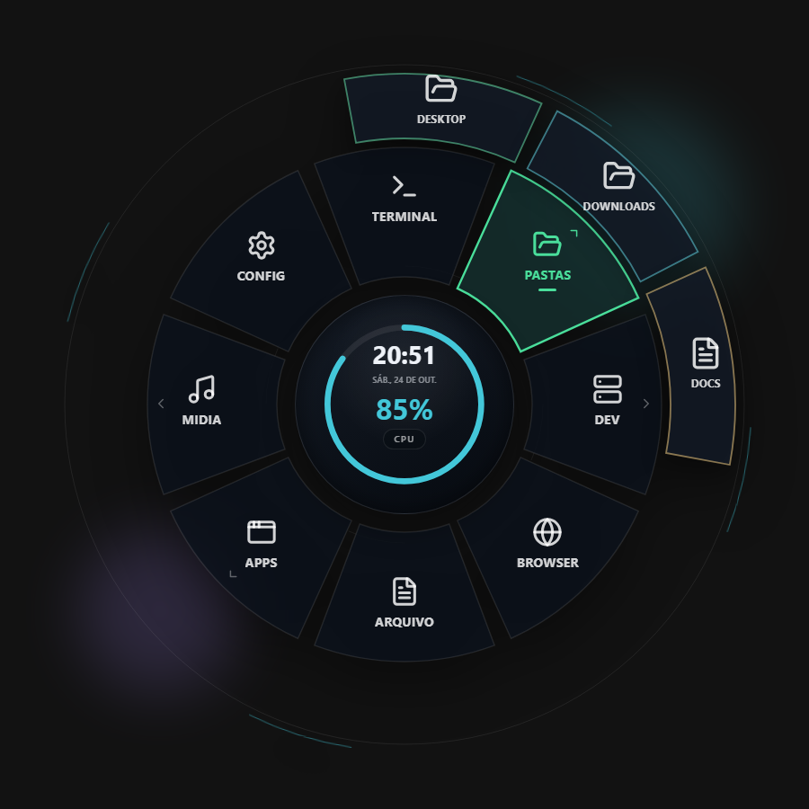
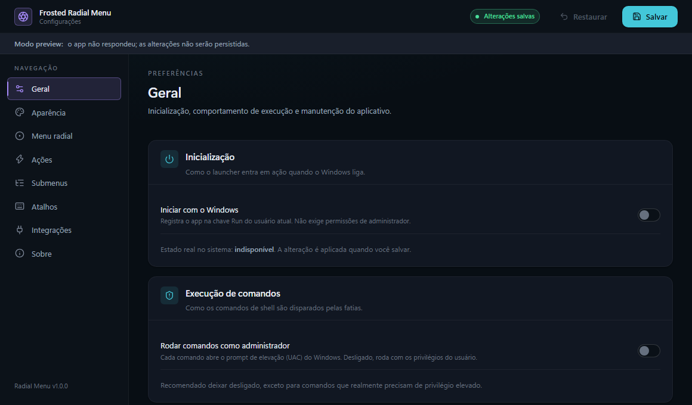
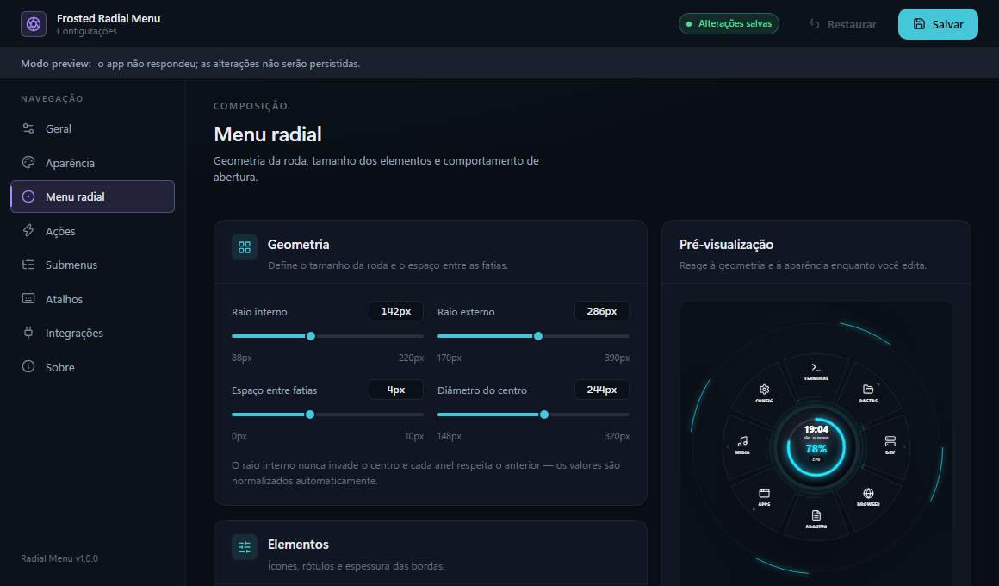

<div align="center">

# 🌌 Frosted Radial Menu



**Launcher radial desktop para Windows, com design futurista e alta performance.**

[](#)
[](#)
[](#)
[](#)
[](#)
[](https://github.com/NakamuraIA/frosted-radial-menu/releases/latest)

*Leve, animado, customizável e compilável para `.exe` sem depender de APIs externas.*

</div>

<hr/>

## ✨ Recursos Principais

- 🔘 **Menu radial transparente**: fatias com estados distintos de hover, foco e seleção, abertura suave e respeito a `prefers-reduced-motion`.
- 📂 **Submenus inteligentes**: abrem na direção da fatia clicada, com até **8 filhos** e modo compacto automático.
- 📊 **Centro informativo**: hora, data e uso real de CPU (com opção de ocultar percentuais).
- ⚙️ **Painel em 8 páginas**: Geral, Aparência, Menu radial, Ações, Submenus, Atalhos, Integrações e Sobre — cada categoria no seu lugar.
- 🎛️ **Rascunho com estado**: indicador de alterações pendentes, Restaurar com confirmação e prévia do radial reagindo ao que você edita.
- 💾 **Presets**: exporte/importe a configuração em JSON com validação (recusa arquivo inválido, vazio ou acima de 1 MB).
- 🎨 **Personalização completa**: cores, vidro, glow, animação, escala, raios, espaçamento, ícones, textos e fonte.
- 🖥️ **Modo de janela por ação**: mostrar um terminal único (PowerShell ou CMD) ou ocultar a janela quando o comando já abre as suas.
- 🦀 **Backend em Rust**: abre arquivos/pastas/URLs, roda comandos, controla janelas e coleta CPU/RAM.
- 🖱️ **Bandeja + atalho global**: `Alt+Space` por padrão, re-registrado ao salvar.
- 🚀 **Auto-start sem admin**: chave `Run` do usuário no registro, com estado real exibido no painel.

---

## 📸 Capturas

<div align="center">





</div>


---

## 🛠️ Stack Tecnológico

- **Frontend**: React, TypeScript, Vite, `lucide-react`.
- **Backend / Desktop**: Tauri 2, Rust.
- **Sistema Alvo**: Windows.

---

## 📂 Estrutura do Projeto

**Frontend** (`src/`)

- `components/radial/`: menu — `RadialMenu` (container), `RadialCanvas`, `MainSlice`, `SubmenuSlices`, `CenterDashboard`, `SliceContent`, `geometry.ts` e `themeVars.ts`.
- `components/settings/`: janela de configurações — `SettingsShell` (topbar + navegação + rascunho) e `pages/` com Geral, Aparência, Menu radial, Ações, Submenus, Atalhos, Integrações e Sobre; `MenuPreview` para a prévia ao vivo.
- `components/ui/`: primitivas reutilizáveis — `Button`, `Card`, `Field`, `Slider`, `Switch`, `Badge`, `ConfirmDialog`, `PageHeader`.
- `components/common/`: `CustomIcon` e `renderIcon` compartilhados.
- `hooks/`: `useRadialConfig`, `useSystemStats`, `useClock`, `useMenuVisibility`, `useSettingsDraft`.
- `lib/config/`: tipos, opções, defaults, normalização e operações de árvore.
- `lib/`: `api.ts` (wrapper tipado do `invoke`), `icons/`, `format.ts`, `id.ts`.
- `styles/`: `tokens.css` (design tokens), `index.css` e `app.css`.

**Backend** (`src-tauri/src/`)

- `lib.rs`: só a montagem do `Builder` (estado, plugin, comandos, setup).
- `commands/`: superfície `invoke` — valida e delega.
- `config/`: `model`, `defaults` e `store` (JSON + migração de caminho).
- `menu/`: `actions` (dispatch) e `shell` (PowerShell/CMD).
- `platform/`: `hotkey` (atalho global) e `autostart` (`HKCU\...\Run`).
- `system/`: métricas de CPU/RAM.
- `ui/`: `windows`, `placement` (clamp no monitor) e `tray`.

Outros: `src-tauri/tauri.conf.json` (config central), `docs/PLAN.md` (plano de produto).

---

## 💻 Desenvolvimento

Em ambiente de desenvolvimento, o comando abaixo sobe o Vite e o backend Tauri em conjunto:

```bash
npm install
npm run tauri dev
```

> **Nota:** O Vite utiliza a porta `http://127.0.0.1:5180`. Se a porta estiver ocupada, encerre o processo no PowerShell antes de tentar novamente:
> ```powershell
> Get-NetTCPConnection -LocalPort 5180 -State Listen
> Stop-Process -Id <PID> -Force
> ```

💡 **Dica:** Se o atalho global não estiver abrindo o menu, pode haver outra instância antiga rodando em segundo plano. Feche-a pelo ícone da bandeja ou encerre o processo antes de rodar o comando novamente.

---

## ✅ Validação

Comandos úteis para manter a qualidade do código:

```bash
npm run lint                  # eslint (inclui regras do React Compiler)
npm run test                  # vitest — funções puras do painel
npm run build                 # tsc -b && vite build
cargo check --manifest-path src-tauri/Cargo.toml --all-targets
cargo test  --manifest-path src-tauri/Cargo.toml
```

O CI (`.github/workflows/ci.yml`) roda esses mesmos passos em `windows-latest` a cada push/PR.

---

## 📦 Build para Windows

```bash
npm run tauri build
```

Os artefatos gerados ficarão nos seguintes diretórios:
- **Instalador NSIS:** `src-tauri/target/release/bundle/nsis/` (arquivo `-setup.exe`)
- **Binário Direto:** `src-tauri/target/release/Frosted Radial Menu.exe`

### ℹ️ Detalhes da Instalação
O app **não** precisa de Node.js ou Rust no computador do usuário final. Essas ferramentas são usadas apenas para desenvolvimento e compilação.
- O runtime utilizado é o **Microsoft Edge WebView2**. O instalador utiliza a diretiva `downloadBootstrapper` para baixar e instalar o WebView2 caso ele não exista na máquina.
- A instalação utiliza `installMode: currentUser`, instalando apenas para o usuário atual e evitando pedidos de permissão de administrador (UAC).
- O NSIS copia o app para `%LOCALAPPDATA%\Frosted Radial Menu` e cria atalhos no **Menu Iniciar** e na **Área de Trabalho**.

> ⚠️ Os executáveis (`.exe`) não devem ser commitados no repositório. O ideal é publicá-los nas **Releases do GitHub**.

---

## 🌍 Portabilidade

Este projeto foi desenhado para **não** depender de caminhos específicos do computador do desenvolvedor. Utilize variáveis de ambiente do Windows nas configurações para garantir que funcione em qualquer máquina:

- `%USERPROFILE%\Desktop`
- `%USERPROFILE%\Downloads`
- `%APPDATA%`
- `%LOCALAPPDATA%`

As configurações reais do usuário ficam fora do repositório. Arquivos locais, presets pessoais, builds, screenshots de QA e caches estão ignorados no `.gitignore`.

---

## 🗺️ Roadmap

- [x] Criar/remover atalho na Área de Trabalho pelo painel de configurações.
- [x] Importar e exportar presets de personalização (JSON, com validação na importação).
- [x] Reordenar fatias e submenus diretamente no painel (arrastar-e-soltar).
- [x] Detectar aplicativos comuns do PC do usuário para montar um preset inicial automatizado.
- [ ] Atalhos por ação (hoje só existe a combinação global).

---

## 📄 Licença

**MIT**. Veja o arquivo `LICENSE` para mais detalhes.

<br/>

<div align="center">
  
</div>
